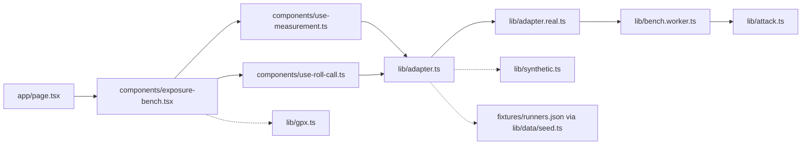

# Velatum

Velatum shows how someone would find your home from the run and ride recordings you share, then measures how far each hiding setting throws that guess off. People who post their activities publicly trust a privacy zone to hide their front door, and nobody gives them a way to check that it does.

Live: https://velatum-five.vercel.app/?runner=maya. Start at DEMO.md step 1.

The live URL runs both attacks in your tab on synthetic sample runners; drop your own GPX files and they are measured the same way, and the files stay in this tab.

## Try it in 60 seconds

1. Open https://velatum-five.vercel.app/?runner=maya. The sample runner Maya is loaded on Fig. 1.
2. Click "No zone" in cell 3 and read the distance in cell 2.
3. Click "200 m zone". The gold circle appears around her home and cell 2 stays red.
4. Drag the gold handle on Fig. 1 away from the home (or use the arrow keys on it), or click "Offset + ragged edge". The number in cell 2 climbs and the roll call in cell 6 is measured again.
5. Click "Download cleaned GPX". One metadata-free file downloads, cut exactly as measured.

## Addresses

| What | Address |
| --- | --- |
| Live app | https://velatum-five.vercel.app |

There is no contract, no chain and no server API that takes input.

## The problem

People who share their runs and rides publicly, especially women who run alone and students who train at night, give away more than a route. Most recordings start and stop at the front door. Fitness apps offer a privacy zone that hides the first and last stretch, and most people assume that settles it.

It does not. Hassan et al. (USENIX Security 2018) showed that the hidden location can be recovered from protected activities. Dhondt et al. at KU Leuven (ACM CCS 2022) reported recovery rates up to about 85% depending on attack and dataset. Nobody gives the person at risk a way to check their own setting. We could not find a single public tool that looks at a GPX file and says "this points at your home, by this many meters".

## The solution

Velatum is one screen. You load your GPX files (or keep the synthetic sample runner that is already loaded) and the page runs two attacks on them:

1. **Start and finish clustering.** DBSCAN (75 m radius, 3 points minimum) groups every start and finish point. The densest group's centroid is the guess for home.
2. **Zone edge circle fit.** A privacy zone cuts everything within a fixed radius of its center, so the points where tracks reappear lie on a circle. RANSAC throws out the exits that do not fit, then a Kasa least-squares fit recovers the circle, and the hidden center with it.

Then you defend. Three sliders: zone radius, how far to move the zone center away from home (along one secret direction), and an extra random length cut from each recording. The zone center is also a gold handle on the plot that you can drag along that direction. Every change re-runs both attacks and the big number updates: the distance from the closer guess to the home. When you are happy, you download the cleaned GPX, cut exactly as measured.

### Architecture



### A safe outcome, step by step

Open the sample runner Maya (24 synthetic night runs) and follow the result card:

- **No zone.** The start and finish cluster lands a few meters from her door. Red card.
- **200 m zone, centered on the door** (what most apps do). The circle fit recovers the hidden center almost exactly. Still red. The zone was not protecting her.
- **Offset + ragged edge preset** (1 km zone, center moved 700 m, up to 400 m extra cut per recording), or drag the gold handle yourself. Both attacks now guess hundreds of meters away. The card turns green and the cleaned file downloads with those cuts.

Every sample state is encoded in the URL (`/?runner=maya&zone=1000&offset=700&trim=400`), so a judge can open the exact same measurement we did.

<!-- PROOF:BEGIN bench-numbers -->
Measured by `npm run proof` on 2026-11-25 with the same `runBench` the Web Worker runs (runner Maya, fixed seed).

| Preset | Closest guess | Distance to sample home | Verdict |
| --- | --- | --- | --- |
| No zone | start and finish clustering | 2 m | exposed |
| 200 m zone | zone edge circle fit | 1 m | exposed |
| Offset + ragged edge | start and finish clustering | 447 m | protected |
<!-- PROOF:END bench-numbers -->

### A limitation we want you to know about

Velatum measures the geometry left in the file. It does not cover the distance leak attack from the CCS 2022 paper, where an app still displays the full distance of a run and that number gives the zone away. Hide total distance in your app as well. More limitations are listed on the How it works page.

## Measured results

`npm run proof` computes these with the same `runBench` the Web Worker runs and rewrites only the blocks below.

<!-- PROOF:BEGIN bench-runners -->
Headline distance from the closer guess to each synthetic sample home, measured on 2026-11-25.

| Runner | No zone | 200 m zone | Offset + ragged edge |
| --- | --- | --- | --- |
| Maya R. | 2 m | 1 m | 447 m |
| Kerem A. | 2 m | 4 m | 426 m |
| Aylin D. | 1 m | 1 m | 333 m |
| Jonas W. | 5 m | 0.79 km | 0.53 km |
| Priya S. | 1 m | 3 m | 0.57 km |
| Tomás L. | 2 m | 206 m | 0.51 km |
| Sofia M. | 3 m | 1 m | 228 m |
| Elif K. | 2 m | 1 m | 0.78 km |
<!-- PROOF:END bench-runners -->

<!-- PROOF:BEGIN roll-call -->
Roll call (demo step 8), measured by `npm run proof` on 2026-11-25 with the same `runBench` and verdict as cell F. Protected means both attacks miss by 400 m or more, or nothing is left to attack.

| Preset | Sample runners protected |
| --- | --- |
| No zone | 0 of 8 |
| 200 m zone | 1 of 8 |
| Offset + ragged edge | 6 of 8 |
<!-- PROOF:END roll-call -->

<!-- PROOF:BEGIN bench-tests -->
`npm test` on 2026-11-25: 16 passed, 0 failed.

Worker latency is measured in the browser and shown under the result; this script does not measure it.
<!-- PROOF:END bench-tests -->

<!-- PROOF:BEGIN demo-path -->
Measured by `npm run proof` on 2026-11-25 in Node with the same `runBench` the Web Worker runs.

| Check | Value | Budget |
| --- | --- | --- |
| Slowest `runBench` over 8 runners x 3 presets (Sofia M., 200 m zone) | 6 ms | 5000 ms |
| Step 5 file size, Maya at "Offset + ragged edge" | 274221 bytes | none |
| Step 5 file identical across two `serializeGpx` calls (sha256) | match `88c440f22d3f` | match |
| Worst-case worker wait, 2000 ms x 2 attempts | 4000 ms | 5000 ms |
<!-- PROOF:END demo-path -->

## Data, reset and fallbacks

Velatum has no store. Every demo step only reads seeded or computed data: the synthetic runners come from `fixtures/runners.json` through `lib/data/seed.ts`, and everything else lives in memory in your tab. Uploaded tracks are never written to `localStorage`, `sessionStorage`, IndexedDB or a server, so closing the tab forgets them.

Migrations: none, there is no database.

`npm run demo:reset` runs the seed script twice, checks that both runs write the same `fixtures/seed-manifest.json` (sha256), prints the hash and the start route `/?runner=maya`. Nothing else holds demo state.

The bench runs in a Web Worker by default (`ADAPTER_MODE=real`). One worker attempt may take 2 seconds, it is retried once on a fresh worker, and then the page computes the result itself, so no step waits longer than 5 seconds. `ADAPTER_MODE=fake` forces the main-thread bench.

| Step | File | Real path | Fallback |
| --- | --- | --- | --- |
| 1. Open Maya | `components/use-measurement.ts`, `lib/adapter.real.ts` | Seeded number from `measureNow`, then the worker | Main-thread `runBench` in `measureInWorker` |
| 2 to 4. Presets, sliders and the zone handle | `components/use-measurement.ts`, `lib/adapter.real.ts`, `components/zone-handle.tsx` | Worker measure, latest wins, stale results hidden | Main-thread `runBench` after one retry |
| 5. Download | `components/exposure-bench.tsx` (`guardDownload`) | GPX cut from the measurement on screen, disabled while pending or stale | `DownloadErrorState` with "Try the download again" |
| 6. Your files | `components/upload-cell.tsx` | Read with DOMParser in the tab, staged states | `UploadErrorState` with "Choose other files" |
| 7. Evidence and limits | `components/result-cell.tsx`, `app/about/page.tsx` | Evidence dialog and limitation list | `LimitationsEmptyState` links back to Maya; `app/error.tsx` covers both routes |
| 8. Roll call | `components/use-roll-call.ts`, `components/exposure-bench.tsx` (cell F) | Every sample runner measured at the current settings through the same worker, latest wins, paused while cell B measures | Main-thread `runBench`; on rejection the error state with "Measure the roll call again" |

## Trust and responsible design

- Files are parsed in the browser. The production Content-Security-Policy sets `connect-src 'self'`, so the page physically cannot send them to another origin.
- No map tiles. A tile server would learn which neighborhood you are looking at, so the plot is a plain plane view.
- It reads only files you already have. There is no search for other people's profiles and no scraping.
- All demo data is synthetic. Sample homes sit on a fictional street grid at 0°N 0°E, in open sea, so no demo coordinate is anyone's address.
- Uploaded files never reach the URL. For your own files there is no known "true home", so Velatum measures from the raw-file guess and says so on screen.

## Prizes and required tech

No prize track names a sponsor product; all four tracks are automatic entries in the overall ranking, so there is no bounty table and no sponsor integration. `portfolio.bounties` is empty. The track names are listed in DELIVERY.md.

The core is our own code: a GPX reader and writer on the browser's DOMParser, a seeded synthetic runner generator, DBSCAN, the Kasa circle fit, RANSAC, and the defense model, all in `lib/`.

The bench runs in a Web Worker in your tab (`lib/bench.worker.ts`): every message is checked with zod, a hung worker is restarted once, and if it still fails the page computes the result itself and says so under the number.

## Tech stack

- Next.js 15 (App Router), React 19, TypeScript 5 (strict)
- Tailwind CSS 4 with shadcn/ui-style primitives, lucide-react
- Motion 14 (`motion/react`) for three interactions: the result number growing into the evidence dialog (shared layout), the draggable zone handle on Fig. 1 (pan gesture bound to the offset), and the staged upload and roll call states (`AnimatePresence`)
- Hand-written DBSCAN, Kasa fit and RANSAC (no geometry or clustering library)
- Web Worker (browser platform API) so the bench never blocks the page
- zod 4 for worker message validation
- Vitest 3 for the snapshot and property tests, tsx 4 to run the proof script
- Deployed on Vercel with a strict CSP

## Quickstart

```bash
npm install
npm run dev          # open http://localhost:3000
npm test             # snapshot and property tests over the seeded runners
npm run proof        # measures the runners and rewrites the Measured results blocks
npm run demo:reset   # checks the seed is deterministic and prints the demo start route
```

No environment variables are needed. `npm run build && npm start` runs the production build with the CSP enabled.

## What was built during the event

Built during SafeSpace Hacks: everything in `lib/` (GPX reader and writer, synthetic generator, both attacks, defenses), every component in `components/` except the primitive patterns, all pages and copy, and the illustrations.

Pre-existing and credited: Next.js, React, Tailwind CSS, the shadcn/ui primitive patterns in `components/ui/`, Motion, zod, lucide-react, and the Cormorant Garamond and Mulish typefaces from Google Fonts. The attack ideas come from Hassan et al. (USENIX Security 2018) and Dhondt et al. (ACM CCS 2022).

## What we would build next

- Cover the distance leak: compare displayed distance with visible distance and flag zones that leak through it.
- Report the average error over 20 seeds per sample runner, so the defense presets are tuned on numbers, not intuition.
- An optional map view with a clear warning that the tile server sees the area.
- Strip or shift timestamps as a fourth defense.

## AI use

The hackathon's policy, as the record states it: "AI tools may be used; AI assistance must be named in the credits."

AI coding agents (Claude Code) drafted much of the code and documentation from the builder's specifications. The builder chose the problem, directed and reviewed the changes, and ran the demo. The product itself calls no AI model.

## License

MIT, see [LICENSE](LICENSE).
